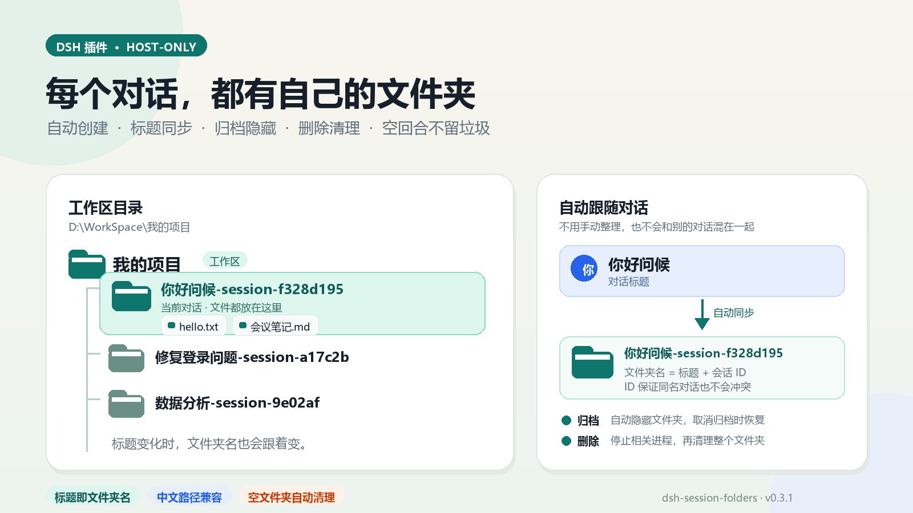

# dsh-session-folders

[中文](#中文) | [English](#english)

> 让每个 DSH 对话在工作区里拥有自己的文件夹：自动创建、跟随标题、归档隐藏、删除清理，并让中文路径下的脚本正常运行。
>
> Give every DSH conversation its own folder inside the workspace: created automatically, renamed with the title, hidden on archive, cleaned up on deletion, and safe for scripts under non-ASCII paths.



*示意图：工作区中的对话文件夹，以及“标题 + 会话 ID”的命名方式。*

---

## 中文

### 这个插件解决什么问题

DSH 的多个对话通常会共用同一个工作区目录。对话一多，临时文件、生成结果和脚本产物就容易混在一起：不知道哪个文件属于哪次对话，归档后的对话也会继续占据目录；如果工作区路径包含中文，一些旧脚本还会因为编码或路径处理问题运行失败。

`dsh-session-folders` 把这些事情交给插件自动完成：

- 每开一个新对话，就在当前工作区里创建一个专属子文件夹；
- 文件夹名始终跟着对话标题走，并附上完整的会话 ID，避免重名；
- 会话实际使用一个 ASCII 路径作为工作目录，但文件仍然保存在真实的中文文件夹里；
- 对话归档时隐藏文件夹，取消归档时恢复；
- 删除对话时停止相关后台任务和进程，再清理文件夹；
- 空对话不会留下空文件夹；下一次发送消息时会自动重建。

### 效果


*示意图：空文件夹清理、下一次发送时重建，以及产生文件后保留文件夹。*

一个典型的目录结构如下：

```text
我的项目/
├─ 你好问候-session-f328d195-45bf-431d-960e-9e7c3fa1e0fc/
│  ├─ hello.txt
│  └─ 会议笔记.md
├─ 修复登录问题-session-a17c2b3d-...
└─ 数据分析-session-9e02af...
```

新对话刚创建、标题还没生成时，文件夹名是：

```text
新对话-<session-id>
```

DSH 自动生成标题，或者你手动重命名对话之后，文件夹会同步变成：

```text
<对话标题>-<session-id>
```

例如：

```text
修复登录问题-session-a17c2b3d-8c91-4a02-9d77-5e6f70819233
```

文件夹名里的会话 ID 是完整的，因此即使两个对话标题完全相同，也不会发生文件夹冲突。

### 功能明细

| 场景 | 插件行为 |
| --- | --- |
| 新建对话 | 在工作区根目录创建 `<标题>-<会话ID>` 文件夹，并把该对话的有效工作目录指向它。 |
| 自动生成标题 | 收到 `session/title` 事件后，立即把文件夹重命名为新标题；标题里的 Windows 非法字符会被替换，过长标题会截断。 |
| 手动重命名对话 | 与自动标题一样同步文件夹名；会话 ID 保持不变，所以路径仍然稳定。 |
| 归档对话 | 给真实文件夹加上 Windows 隐藏属性，并删除 ASCII junction，避免归档对话的文件继续出现在工作目录中。 |
| 取消归档 | 去掉隐藏属性，重建 ASCII junction，对话可以继续在原文件夹里工作。 |
| 删除对话 | 先停止该会话的后台任务，并尝试停止命令行中引用了该文件夹或 junction 的进程，然后删除 junction 和真实文件夹。只有确认会话持久化记录与工作区登记都已消失后才执行，避免把“Host 退出”误判成删除。 |
| 空回合结束 | 如果一轮对话结束后，文件夹里除了内部标记 `.dsh-session-folder.json` 没有任何文件，就删除空文件夹和 junction。 |
| 下一次发送 | 在下一次系统提示组装、模型调用和工具执行之前，自动重建文件夹与 junction；即使上一轮刚被清空，也不会把工作目录退回工作区根目录。 |
| 非空文件夹 | 只要文件夹里出现任意一个文件，空清理就不会删除它，后续对话继续使用。 |
| 子代理会话 | 子代理不单独创建文件夹，避免一个对话下出现大量无关目录。 |
| 安装前已有的对话 | 不追溯迁移，避免突然改变已有会话的路径；只有安装后新建的对话才会获得文件夹。 |

### 中文路径兼容

这是插件最容易被忽略、但对旧脚本很重要的一部分。

会话的“有效工作目录”会被设置为：

```text
%PUBLIC%\dsh-session-folders\aliases\<session-id>
```

这是一个指向真实对话文件夹的 ASCII junction（目录联接）。真实文件仍然保存在：

```text
<工作区>\<对话标题>-<session-id>\
```

因此：

- PowerShell、Node.js、Python 等进程看到的 `cwd` 是不含中文的 ASCII 路径；
- 通过相对路径创建的文件，最终仍然落在真实的中文文件夹里；
- 以工作目录为基准的旧脚本不需要修改；
- 如果脚本自己硬编码了中文绝对路径，仍然可能受脚本自身的编码处理影响，这类情况不在插件的保证范围内。

插件会优先使用 `%PUBLIC%` 作为 junction 根目录，其次使用 `%ProgramData%`，最后才回退到 `%LOCALAPPDATA%`，从而尽量避免用户名本身包含中文时又把中文带进有效路径。

### 安装

推荐通过 DSH 的插件管理器安装：

1. 在 DSH 的“插件”页面安装 `dsh-session-folders` bundle；市场上架完成后也可以直接搜索插件名。
2. 安装或更新后重启 / 重载 DSH profile，让 Host 端插件生效。
3. 新建一个对话，发送第一条消息，检查工作区中是否出现 `<标题>-<session-id>` 文件夹。

要求：

- DSH 使用 Cordis 4；
- Node.js `^22.15.0 || >=24.0.0`；
- Windows 推荐（隐藏属性和 junction 行为针对 Windows 实现）；其它平台会使用目录符号链接，隐藏行为可能不同。

### 工作方式（技术细节）

1. 监听 `agent/created`，跳过子代理会话；根据会话 header 的 `cwd` 找到所属工作区。
2. 创建真实对话文件夹，写入 `.dsh-session-folder.json` 标记，并创建 ASCII junction。
3. 通过 `session.append('working-directory/change', { cwd: alias })` 静默设置会话的有效工作目录。
4. 监听 `session/title`，把真实文件夹重命名为 `<新标题>-<session-id>`，并重建 junction。
5. 监听 `working-directory/access`：在系统提示和工具读取工作目录之前，如果发现文件夹被空清理删除了，就先重建文件夹和 junction。
6. 监听 `workspace/session-archived` 与 `workspace/session-unarchiving`，处理隐藏属性与 junction。
7. 监听 `session/disposed`，并通过 `sessionPersistence` 和工作区登记双重确认后，执行删除清理。

插件是 Host-only 的，不注入客户端 UI，也不修改 DSH 的会话存储格式。

### 已知边界

- 只有安装后新建的对话会创建文件夹；已有对话不会自动迁移。
- 如果模型主动使用工作区之外的绝对路径写文件，文件不会被强制移动回对话文件夹。
- 删除时的进程清理是 best-effort：会匹配命令行或可执行文件中包含对话文件夹 / junction 路径的进程；如果进程隐藏了路径信息，无法保证一定能找到。
- 标题中的非法字符会被替换，超过 80 个字符的标题会截断；这些处理是为了保证 Windows 路径合法。
- 归档隐藏依赖 Windows 文件属性；在非 Windows 平台上文件夹仍会保留，但隐藏效果可能不同。

### License

MIT

---

## English

### What it does

`dsh-session-folders` is a Host-only DSH plugin that gives every new conversation a dedicated folder inside the selected workspace.

It keeps that folder in sync with the conversation title, hides it when the conversation is archived, restores it when the conversation is unarchived, removes it when the conversation is permanently deleted, and recreates it before the next turn if an empty-turn cleanup removed it.

The plugin also solves a common problem with non-ASCII workspace paths: the conversation's effective working directory is an ASCII junction under `%PUBLIC%\dsh-session-folders\aliases\<session-id>`, while the real files stay in the real folder inside the workspace. Node.js, Python, PowerShell, and legacy scripts therefore see an ASCII-only `cwd`.

### Features

- **New conversation folder** — creates `<title>-<session-id>` (initially `新对话-<session-id>`). Existing conversations are not migrated retroactively.
- **Title sync** — renames the folder in place when DSH generates a title or the user renames the conversation.
- **Archive / unarchive** — hides the real folder with the Windows hidden attribute and removes the junction on archive; unhides and recreates the junction on unarchive.
- **Delete cleanup** — stops the session's background jobs and matching processes, removes the junction, and recursively deletes the conversation folder after the session is permanently deleted.
- **Empty-turn cleanup** — if a turn ends with no user files (only `.dsh-session-folder.json`), the empty folder and junction are removed. The next turn recreates both during working-directory validation, before the system prompt, model call, and tools run. A folder containing any file is kept.
- **Non-ASCII path compatibility** — the effective working directory is an ASCII junction pointing at the real conversation folder. Files still live in the real folder.

### Install

Install the bundle through the DSH plugin manager (or the marketplace once listed), then restart or reload the DSH profile. The plugin is Host-only and has no client UI.

Requirements:

- DSH with Cordis 4
- Node.js `^22.15.0 || >=24.0.0`
- Windows recommended for the hidden-attribute and junction behavior; other platforms use directory symlinks and may have different hiding behavior.

### Notes

- Only genuinely new conversations get a folder. Conversations created before installing the plugin are not migrated.
- The folder is named after the current conversation title; invalid Windows filename characters are replaced and long titles are truncated.
- The ASCII junction is an implementation detail. Files always live in the real folder inside the workspace.
- Delete cleanup is best-effort: it matches processes whose command line or executable path references the conversation folder or junction. A process that hides its path cannot be guaranteed to be found.

### License

MIT
